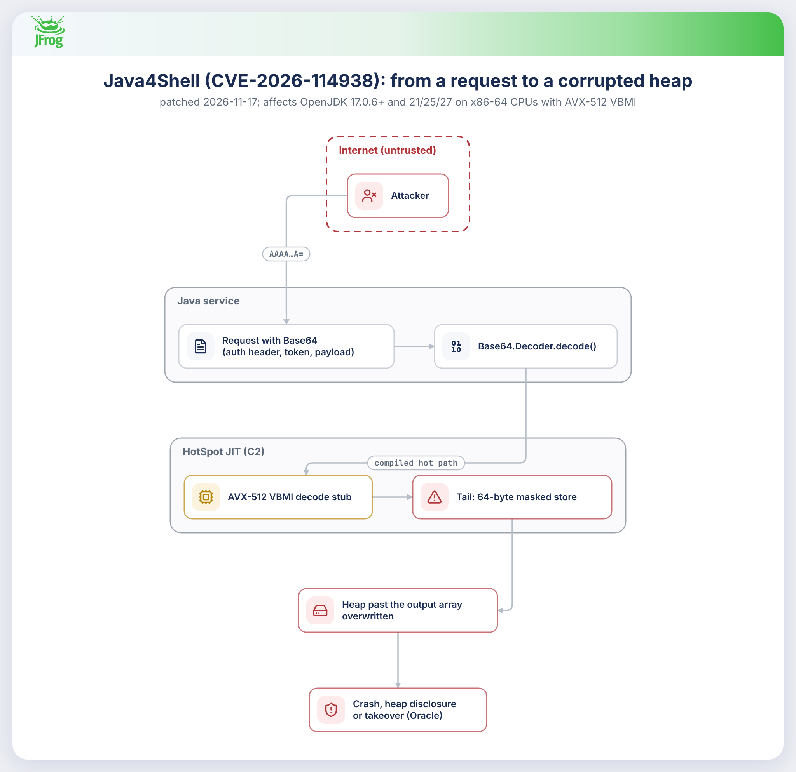
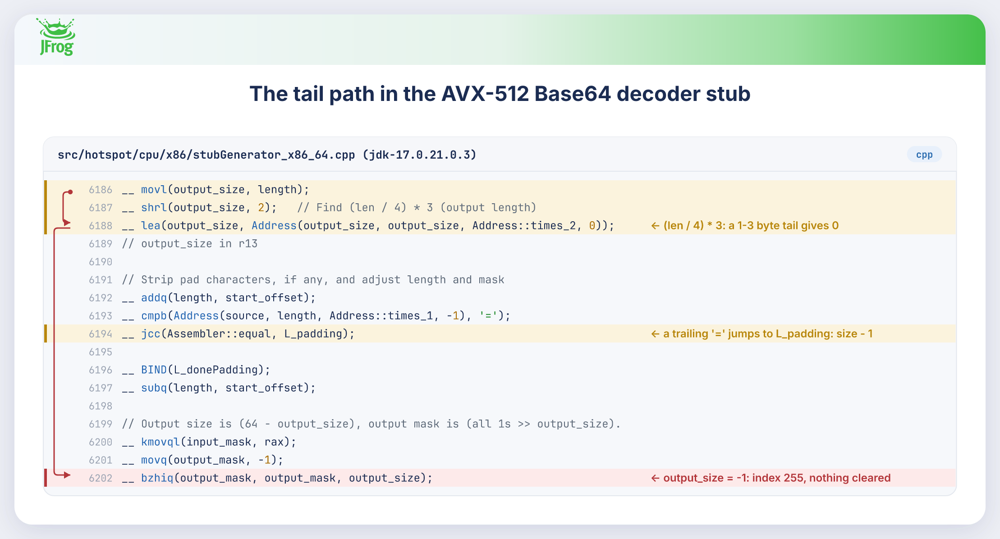
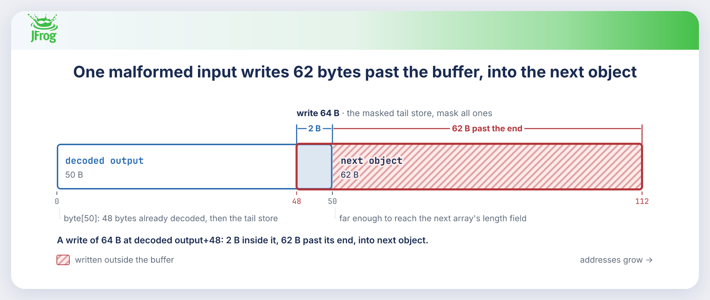
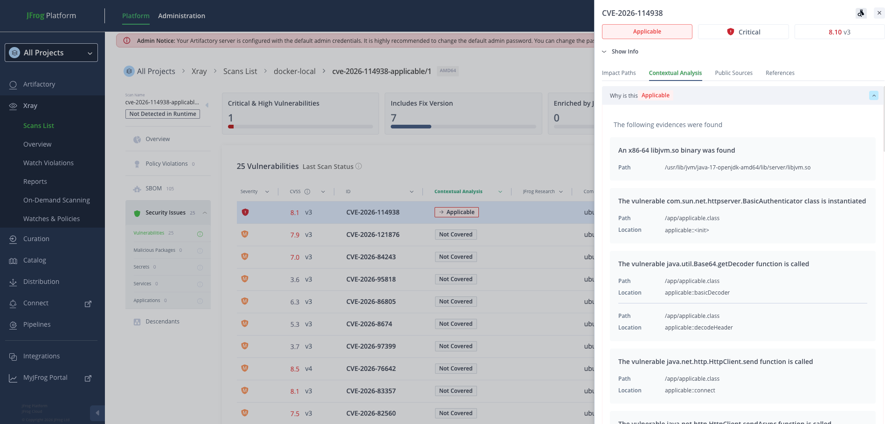
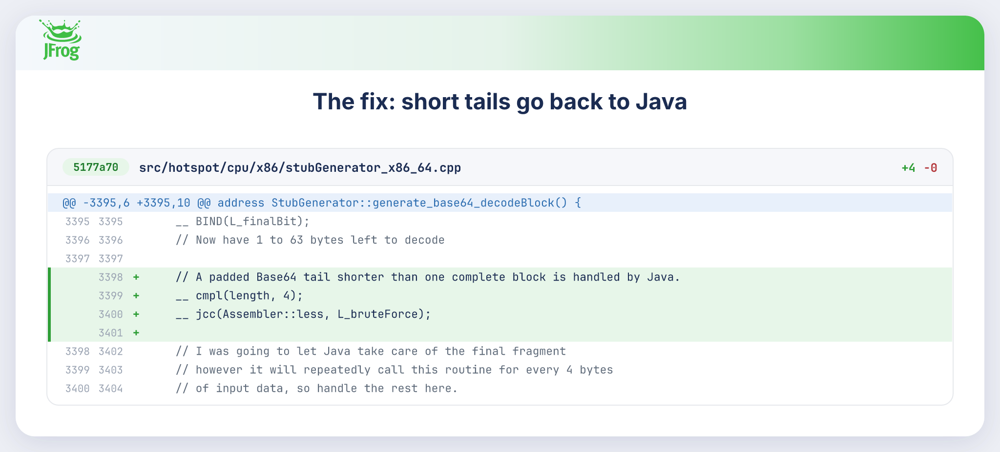

A critical remote code execution vulnerability affecting OpenJDK Java 17, 21, 25 and 27 has been reported under CVE-2026-114938, informally known as **Java4Shell** (also referred to as Java2Shell). The vulnerability is reportedly exploitable without authentication (in some cases) and has been assigned a preliminary CVSS v4.0 score of 9.2 (Critical).

The vulnerability was reported by **Calif**, which announced its discovery and the planned technical disclosure in [this post on X](https://x.com/calif_io/status/2122724367654334810).

With Java widely used across enterprise applications, backend services, and production environments, organizations should start identifying potentially affected Java deployments and prepare for remediation.

## **Who Is Vulnerable to Java4Shell?**

You are vulnerable only when **all three** of the following are true:

* **You run an affected Java runtime** - OpenJDK 17.0.6 or newer (branches 17, 21, 25 and 27), or a distribution built from it: Oracle Java SE, Eclipse Temurin, Amazon Corretto, Microsoft Build of OpenJDK, Azul Zulu, BellSoft Liberica, SAP SapMachine, Red Hat OpenJDK or Oracle GraalVM. Standard Java 8 and 11 builds are *not* affected, and neither is OpenJ9. Oracle's Java 8 Enterprise Performance Pack *is* affected.
* **You run on x86-64 hardware with AVX-512 VBMI** - Intel Xeon Ice Lake or newer (Sapphire/Emerald/Granite Rapids), or AMD Zen 4 or newer. ARM64 machines (AWS Graviton, Apple Silicon) are *not* affected.
* **Your application decodes Base64 that comes from outside** - HTTP Basic-auth headers, JWTs, file uploads, network messages. This is extremely common, and it usually happens before any authentication check.

If any one of these does not hold on a machine, Java4Shell cannot be triggered there. The next two sections show exactly which versions need an update and how to check your own hosts.

## **Affected and Fixed Versions**

| Java branch | Affected versions | Fixed in |
|---|---|---|
| 17 | 17.0.6 through 17.0.21.0.3 | **17.0.21.1** |
| 21 | up to 21.0.13.0.3 | **21.0.13.1** |
| 25 | up to 25.0.5.0.3 | **25.0.5.1** |
| 27 | up to 27.0.1.0.3 | **27.0.1.1** |
| 8 (Enterprise Performance Pack only) | 8u511b33-perf | **8u513-perf** |

Standard Java 8 and 11 releases are not affected and need no action. There are **no fixes for branches 18-20, 22-24 and 26** - move to a supported line. Distributions ship their own builds of these fixes (for example Corretto 17.0.21.1.2).

Organizations should inventory their Java applications, deployments, and internet-facing instances and update to one of the fixed versions above.

## **How Can I Check If I'm Affected?**

Run this short script on each Linux host. It first checks that the CPU can run the vulnerable decoder at all (x86-64 with AVX-512 VBMI), then whether the `java` on your `PATH` is in an affected range, and prints the reason either way:

```sh
#!/bin/sh
# Java4Shell (CVE-2026-114938) quick check: CPU and the java on PATH.
# The vulnerable AVX-512 Base64 decoder only runs on x86-64 with these flags:
[ "$(uname -m)" = x86_64 ] || { echo "OK: not x86-64 (the vulnerable code is x86-64 only)"; exit 0; }
for f in avx512f avx512bw avx512vbmi bmi2; do
    grep -qw "$f" /proc/cpuinfo || { echo "OK: CPU has no $f - the AVX-512 decoder never runs"; exit 0; }
done
# Is the java on PATH in an affected range?
v=$(java -version 2>&1 | sed -n 's/.*version "\([0-9.]*\).*/\1/p' | head -1)
[ -n "$v" ] || { echo "no java on PATH; check your apps for bundled JDKs"; exit 0; }
maj=${v%%.*}; rest=${v#*.}; upd=${rest#*.}; pat=${upd#*.}; upd=${upd%%.*}
[ "$pat" = "$upd" ] && pat=0
[ -z "$upd" ] && upd=0
case $maj in
    8|11) echo "OK: Java $v has no AVX-512 Base64 decoder"; exit 0 ;;
    17) [ "$upd" -lt 6 ] && { echo "OK: Java $v predates the vulnerable decoder"; exit 0; }; fix=21 ;;
    21) fix=13 ;; 25) fix=5 ;; 27) fix=1 ;;
    *) echo "Java $v: this branch gets no fix - move to 17, 21, 25 or 27"; exit 1 ;;
esac
if [ "$upd" -gt "$fix" ] || { [ "$upd" -eq "$fix" ] && [ "$pat" -ge 1 ]; }; then
    echo "OK: Java $v is patched"
else
    echo "VULNERABLE: Java $v on an AVX-512 host - update to $maj.0.$fix.1 or start with -XX:-UseBASE64Intrinsics"
fi
```

Two things to keep in mind:

* A safe CPU result means the host *currently* cannot be exploited - use it to prioritize work, not to close findings. The same workload can land on a newer, vulnerable CPU after a resize or rescheduling.
* Repeat the version check for every JDK *bundled inside your products and container images* - OS package updates do not touch bundled runtimes, so those are easy to miss. For container images and build artifacts, JFrog Xray runs the equivalent check automatically - see below.

## **What Is Java4Shell?**

Java4Shell is the informal name given to CVE-2026-114938 by **Calif**, the security research firm that reported the vulnerability. In its [announcement on X](https://x.com/calif_io/status/2122724367654334810), Calif reported the discovery and later [published the technical details](https://calif.io/java4shell/) following Oracle's November security patch release.

According to Calif, Java4Shell is a memory-corruption bug in the x86-64 intrinsic implementation of OpenJDK's Base64 decoder. When the decoder processes padded input (a stray `=` character), it miscalculates the store mask, causing an out-of-bounds heap write past the end of the output buffer. Calif says this can be used for heap disclosure (Heartbleed-style) and for remote code execution.

In essence, any application that decodes externally-supplied Base64 content could be affected:

```
import java.util.Base64;
Base64.Decoder decoder = Base64.getDecoder();
decoder.decode(EXTERNAL_INPUT, ...)
```


The issue only affects x86_64 CPUs that support AVX-512 VBMI (ARM64 is not affected), and impacts OpenJDK 17.0.6 and newer as well as derivatives such as Temurin, Corretto and Oracle Java SE. Calif also claims that several popular Java-based products can be exploited this way, in some cases without authentication.

Note the scoring gap between the reporter and the vendor: Calif assigns 9.2 (Critical) under CVSS v4.0, while Oracle scores the CVE 8.1 (High) under CVSS v3.1, reflecting the high attack complexity of real-world exploitation.

## **Technical Analysis**



*The road to the bug: any Base64 input an application decodes can end up in one vulnerable assembly stub.*

### **How the bug works**

Java is a memory-safe language, but the JVM that runs it is not: much of it is written in C++ and hand-written assembly. To make busy code faster, the JVM's just-in-time compiler (C2) can swap a standard library method for an **intrinsic**: a small, hand-written piece of assembly tuned for a specific CPU. Base64 decoding (`java.util.Base64`) has one of these for x86-64 CPUs with AVX-512 VBMI. It decodes the input in large blocks and writes the results with a *masked store* (`VMOVDQU8`): one instruction that can write up to 64 bytes, where a 64-bit mask says which of those bytes are actually written.



*The vulnerable stub in JDK 17.0.21.0.3: the tail path from `(len / 4) * 3` to the masked store.*

The bug is in how the stub handles the last, partial block of input. To build the mask, it works out how many bytes are left to write:

1. It computes the output length from the input characters that are left: `(len / 4) * 3`.
2. It subtracts 1 for each padding character (`=`).
3. It turns that length into a mask with the `BZHI` instruction, which sets that many low bits.

For a malformed tail such as `=`, `X=` or `===`, step 1 already gives 0, and step 2 then subtracts 1: 0 minus 1 wraps around to -1. `BZHI` reads only the low 8 bits of its input, so -1 is read as 255. An index of 64 or more clears nothing, so the mask comes out as all ones, and the stub writes a full 64 bytes instead of none.

In practice: decode 64 `A` characters followed by a single `=` (128 `A`s on JDK 17). The JVM allocates a 50-byte array for the output and has already filled 48 bytes of it. The broken tail store then writes 64 bytes starting at byte 48: 2 bytes inside the array, and 62 bytes past its end, over whatever object the heap placed next. Java does reject the input with an `IllegalArgumentException`, but only after the bad write has already happened.



*The store starts at offset 48 of a 50-byte array: 2 bytes land inside it, and 62 land in whatever comes next.*

### **From corruption to RCE**

The attacker cannot choose what the overflow writes: the extra bytes are mostly the fixed value `0x9a`. The attacker only controls where they land, and that is enough. Every Java array stores its length in a header just before its data, and the JVM uses that length for bounds checks. Calif's exploit places an array (the *writer*) right after the decoder's output buffer, so the overflow lands on its length field and makes it larger. The writer can now write chosen values past its real end, which Calif uses to enlarge the length of a second array (the *reader*). Reading through the reader then returns heap memory the application never meant to expose, such as keys and tokens ("JavaBleed", similar to Heartbleed). With reads and writes past the end of these arrays, Calif reaches code execution by writing into the JVM's Code Cache, where the JIT compiler keeps the machine code it generates.

The hard part is getting the writer to sit right after the output buffer. Java allocates objects in the G1 heap, so Calif *grooms* it: it allocates many writer/reader pairs and retries until one ends up in the right place. This depends on allocation order and, for remote attacks, on network timing, so each application needs its own exploit chain. There is no universal payload. Still, Calif demonstrated **pre-auth RCE in Keycloak, Atlassian Jira, Atlassian Confluence, JFrog Artifactory, Jenkins and PingFederate** (all in default configurations), and post-auth RCE in Apache Kafka, Apache Solr, Elasticsearch, Gerrit and Spinnaker. A client-side variant was also reported: a Java application that connects to a malicious TLS server can be compromised even if it exposes no service of its own.

### **Why AVX-512 is mandatory for exploitation**

The vulnerable code exists only in the AVX-512 assembly stub. The scalar and AVX2 decode paths are not affected. For an application to be exploitable, **all** of the following must hold:

* **x86-64 CPU**: the stub does not exist on ARM64 or 32-bit x86
* **AVX-512 VBMI support**: all four of `avx512f`, `avx512bw`, `avx512vbmi` and `bmi2` must appear in `/proc/cpuinfo`. In practice this means Intel Xeon Ice Lake or newer (Sapphire/Emerald/Granite Rapids), or AMD Zen 4+
* **Default JVM flags**: `UseAVX=3` and `UseBASE64Intrinsics` enabled (the default on capable CPUs). These are the flags the two mitigations below change
* **A JDK that contains the stub**: the AVX-512 Base64 decoder was only introduced in OpenJDK 17.0.6. Standard Java 8/11 builds and OpenJ9 do not include it
* **A warm decoder**: the intrinsic is only used after the C2 JIT compiles the decode path, which any busy service does within minutes

This hardware requirement shrinks the real-world attack surface. As pointed out in [this tweet](https://x.com/LiveOverflow/status/2122809936640098574), AVX-512 is not available everywhere on the major cloud providers: many AWS, Azure and GCP instance families (older generations, burstable types, and all ARM-based offerings such as AWS Graviton) do not expose it. The same container image can therefore be vulnerable on one node and safe on another, depending on which CPU it runs on.

That said, newer x86 instance families (e.g. AWS c6i/m6i/c7i/c7a/m7a and their Azure/GCP Ice Lake+/Zen 4+ counterparts) **do** meet the requirement, so use CPU flags to *prioritize* patching, not to dismiss findings - the per-host checks are in the *How Can I Check If I'm Affected?* section above.

## **Is Java4Shell Already Detected by JFrog Xray?**

**Yes. CVE-2026-114938 is already represented in JFrog Xray and JFrog Catalog.**

Beyond detection, Xray's Contextual Analysis determines whether the vulnerability is actually *applicable* in a given artifact, including inside Docker containers. Since Java4Shell requires attacker-controlled input to reach `java.util.Base64.Decoder.decode`, a vulnerable JDK installed in an image is not enough on its own. Xray checks the application code in the container for call paths that reach the vulnerable decoder (alongside the underlying JDK and architecture), so teams can prioritize the images that are exploitable:



*Applicable: Xray finds an x86-64 `libjvm.so` from OpenJDK 17, and application code that reaches the vulnerable decoder: it instantiates `com.sun.net.httpserver.BasicAuthenticator` and calls `Base64.getDecoder` and `HttpClient.send`.*


## **Recommended Mitigations**

Updating to one of the fixed versions is the best fix for Java4Shell. The upstream fix is four lines: any tail shorter than one 4-character block goes back to the (safe) Java implementation:



*The upstream fix in full: short tails never reach the assembly stub, so the underflow cannot happen.*

If updating is not possible, the following mitigations are available (either one prevents exploitation):

* Start OpenJDK with `-XX:-UseBASE64Intrinsics`
* Start OpenJDK with `-XX:UseAVX=2` 

**If your Java instance is not x86_64 (ex. Java running on ARM64 or i386/i686) then you are not vulnerable, and you should not apply any of the above mitigations.** `UseAVX` is an x86-only flag; using it on non-x86 Java will make the JVM fail to start ( `Unrecognized VM option 'UseAVX=2'` ). Both mitigations may reduce performance, so we recommend monitoring your application while the mitigations are in place.
