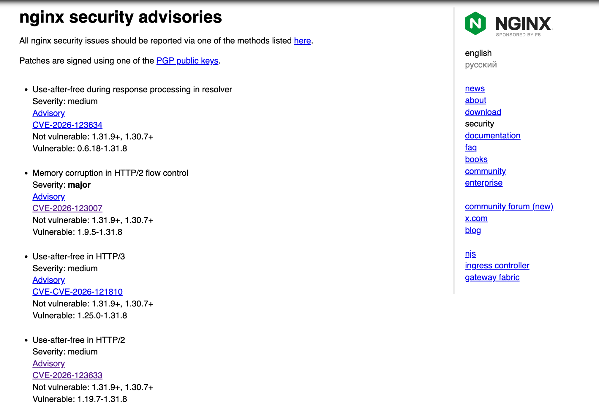
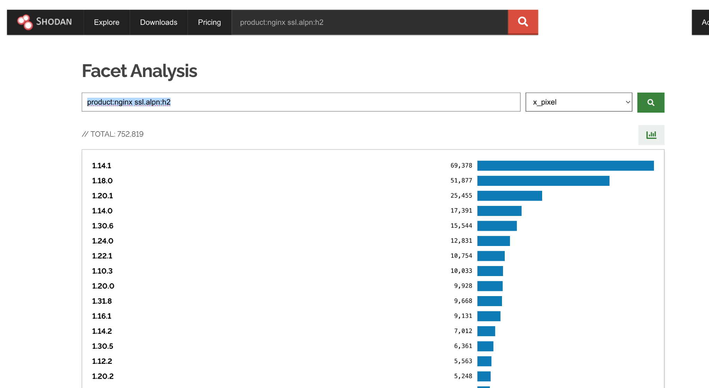
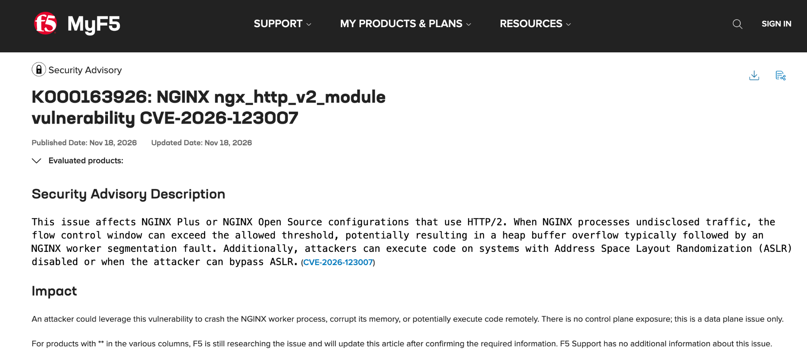
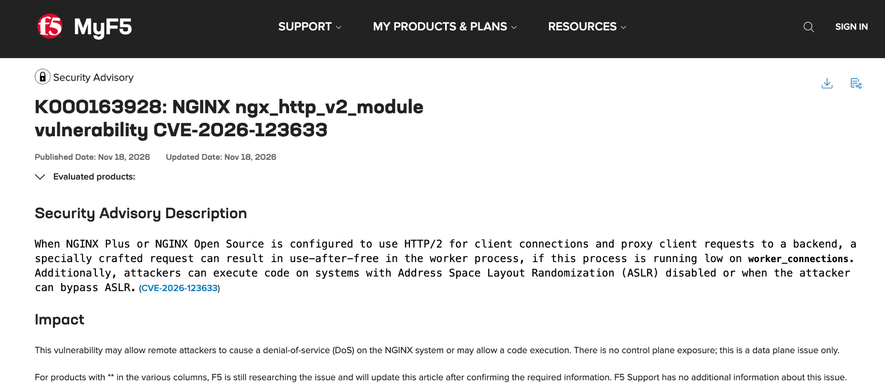
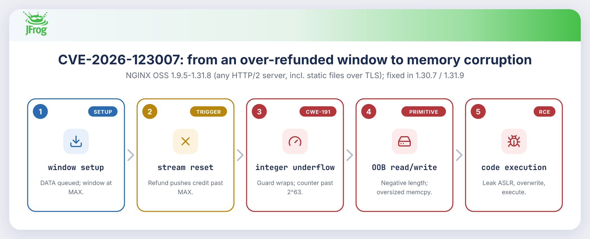
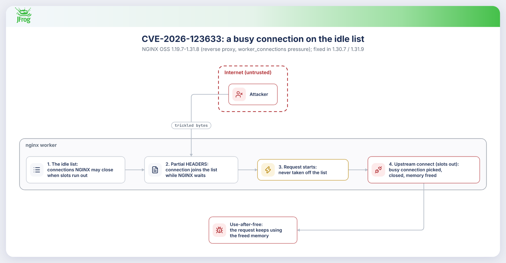
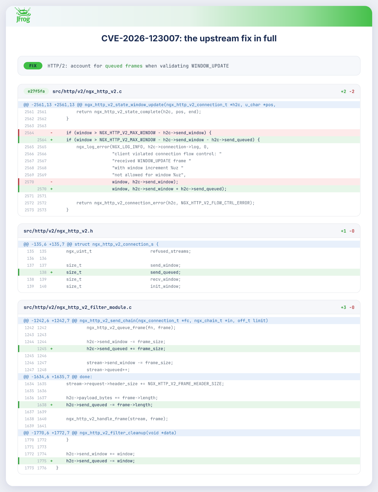
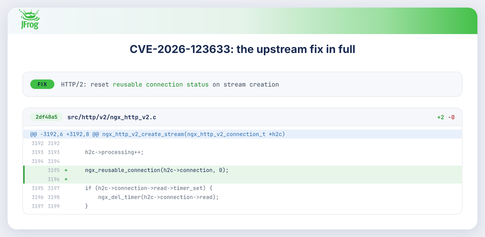
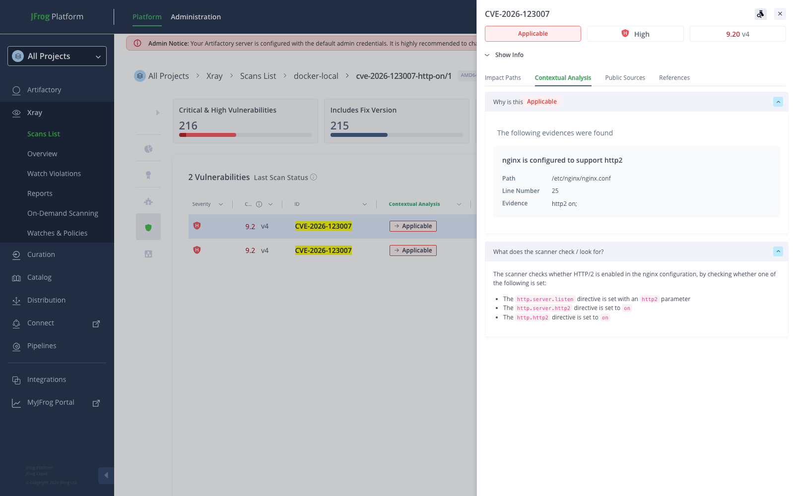

JFrog Security is tracking two Critical severity NGINX vulnerabilities ([CVE-2026-123007](https://www.cve.org/CVERecord?id=CVE-2026-123007), [CVE-2026-123633](https://www.cve.org/CVERecord?id=CVE-2026-123633)), disclosed today and referred to as Nginx2Shell. The vulnerabilities allow unauthenticated remote code execution in NGINX itself, independent of the application running behind it.

On November 18, [F5](https://nginx.org/en/security_advisories.html) released NGINX 1.31.9 and 1.30.7 to address both vulnerabilities, each assigned a CVSS v4.0 score of 9.2.



JFrog Xray and Catalog already include CVE-2026-123007 and CVE-2026-123633 in their vulnerability intelligence, helping teams identify these issues through their existing security workflows. Additionally, our security team has deployed contextual scanners to determine the applicability of these CVEs for customers of JFrog Advanced Security.

The disclosure comes only a month after PHP2Shell and a day after Java4Shell, and follows the same pattern. Old memory bugs in core web infrastructure, found by several research teams at the same time. CVE-2026-123007 has been in NGINX for more than a decade and CVE-2026-123633 for nearly six years. With NGINX serving roughly 30% of the web, even a narrow set of conditions translates into a very large number of exposed servers.

## **Who Is Affected**

NGINX servers that have all of the following attributes are affected -

**Versions:**

* NGINX Open Source 1.9.5 through 1.31.8 (CVE-2026-123007)
* NGINX Open Source 1.19.7 through 1.31.8 (CVE-2026-123633)
* NGINX Plus R33 and later, before the fixed builds listed below

**Configuration:**
HTTP/2 enabled in the NGINX configuration file. CVE-2026-123633 also requires NGINX to proxy requests to a backend (ex. via the `proxy_pass` directive)

**Environment:**
NGINX reachable directly over HTTP/2. CVE-2026-123007 was confirmed on 64-bit servers over HTTPS, even when serving static files only. A CDN or WAF that terminates HTTP/2 in front of NGINX may block parts of the attack.

Note that at the time of writing, the official NGINX Docker images have not been updated yet. Products that bundle NGINX, such as OpenResty and ingress controllers, remain affected until they ship an updated build. kubernetes/ingress-nginx is archived and will not receive a fix.

## **How common is HTTP/2 on NGINX?**

HTTP/2 is now the standard way browsers talk to websites. According to the [HTTP Archive Web Almanac](https://almanac.httparchive.org/en/2024/http), almost 80% of web requests are served over HTTP/2 or newer. [W3Techs](https://w3techs.com/technologies/segmentation/ce-http2/web_server) lists NGINX as the second most common server among HTTP/2 websites, after Cloudflare.

NGINX does not enable HTTP/2 by default, but it takes a single directive to turn it on, and most HTTPS deployments do. The official NGINX packages and Docker images ship with the HTTP/2 module built in.

Not every HTTP/2 site is exposed in the same way. NGINX servers behind a CDN usually receive HTTP/2 traffic from the CDN rather than from the attacker, which may block parts of the attack. The most exposed are NGINX servers that face the internet directly, such as self-hosted web servers, Kubernetes ingress controllers, load balancers and appliances.



## **Am I vulnerable?**

Run the following on the NGINX host/container:

```bash
# NGINX version
nginx -v
# Is HTTP/2 enabled? (any output means yes)
nginx -T 2>/dev/null | grep -nE '^\s*(http2\s+on\b|listen\b[^#]*\bhttp2\b)'
# Is NGINX passing requests to an upstream? (CVE-2026-123633)
nginx -T 2>/dev/null | grep -nE '\b(proxy|fastcgi|uwsgi|scgi|grpc|memcached|tunnel)_pass\b'
```

Your server is affected by CVE-2026-123007 if it runs a version below 1.31.9 (mainline) or 1.30.7 (stable) and the HTTP/2 check returns any output. If the upstream check also returns output, it is affected by CVE-2026-123633 as well.

## **Remediation**

* **Upgrade to NGINX 1.31.9 (mainline) or 1.30.7 (stable). NGINX Plus users should upgrade to 37.0.8.1 or 37.3.0.1.**
* If you cannot upgrade: You can temporarily disable HTTP/2. Set `http2 off` in the affected server blocks (NGINX 1.25.1 and later) and remove the `http2` parameter from your listen directives. Reload NGINX, confirm the old worker processes have exited, and turn HTTP/2 back on after upgrading.

## **The Bugs**

The vulnerabilities enable the following:

* Remote code execution
* Information disclosure
* Denial of service

Both are rated CVSS v4.0 9.2 (8.1 under CVSS v3.1), while [nginx.org](http://nginx.org) rates CVE-2026-123007 as major and CVE-2026-123633 as medium.

**CVE-2026-123007:** An integer underflow in HTTP/2 flow control that leads to an out-of-bounds memory copy. Present since NGINX 1.9.5 (2015) and exploitable even when NGINX only serves static files.



**CVE-2026-123633:** A use-after-free in HTTP/2 connection handling, triggered when NGINX closes a connection that is still serving a request. Present since NGINX 1.19.7 and requires NGINX to pass requests to an upstream while running low on free connections.



## **Technical Details**

[Wiz Research](https://www.wiz.io/blog/nginx-http2-rce-vulnerabilities) disclosed both vulnerabilities, which were independently found by Wiz, Ikotas Labs, Metnir, [Rapid7](https://www.rapid7.com/blog/post/ve-cve-2026-123007-critical-nginx-http-2-integer-underflow-leads-to-rce-fixed/) and Xint, many of them with the help of AI-assisted code analysis. The NGINX fix commits credit Xint.io for CVE-2026-123007 and Albert from Vexera AI for CVE-2026-123633. Rapid7 also published a public PoC for CVE-2026-123007.

Both bugs live in the way NGINX keeps track of HTTP/2 connections. The flow looks like this:

**CVE-2026-123007**

1. HTTP/2 limits how much data a server may send before the client asks for more. NGINX tracks this allowance in a counter.
2. When a stream is cancelled, NGINX adds the unsent data back to the counter without checking the protocol maximum.
3. Once the counter passes that maximum, the check on new WINDOW_UPDATE frames wraps around and lets the attacker keep raising it.
4. The oversized counter turns into a negative length when NGINX prepares data to send, and the TLS layer copies memory out of bounds. This can leak memory and corrupt the heap.



**CVE-2026-123633**

1. NGINX keeps a list of idle connections it can close when it runs out of free connections.
2. A client that sends only part of an HTTP/2 HEADERS frame gets its connection put on that list while NGINX waits for the rest.
3. When the rest arrives and a request starts, the connection is never taken off the list.
4. Later, while opening a connection to the upstream, NGINX may pick this busy connection to close and free its memory. The request keeps using the freed memory, a classic use-after-free.



## **The Fix**

The fix addresses the following:

**The flow-control counter respects the protocol maximum** ([e27f5fa84fe](https://github.com/nginx/nginx/commit/e27f5fa84fe6e98505e70bc543b748747dad0a3b)): NGINX now tracks the data already queued for sending and takes it into account when checking WINDOW_UPDATE frames, so the counter can no longer wrap around.



**Busy connections leave the idle list** ([2df48a501d0](https://github.com/nginx/nginx/commit/2df48a501d0fb8212b7d39dffeeff5876332ba59)): a one-line fix marks the connection as no longer reusable once a request starts, so NGINX can no longer close it while it is still in use.



## **Detection**

There are no confirmed indicators of compromise yet, but the following signs are worth investigating:

* NGINX worker crashes in the error log, such as `worker process 1234 exited on signal 11`
* Unexpected commands or processes spawned by NGINX worker processes
* Long-lived HTTP/2 connections transferring unusually large amounts of data, a possible sign of a CVE-2026-123007 attempt

```bash
# Look for worker crashes
grep "exited on signal" /var/log/nginx/error.log
# In containers, NGINX logs to stderr
docker logs <container> 2>&1 | grep "exited on signal"
```

## **How Can JFrog Help?**



JFrog is tracking both vulnerabilities and helping organizations prepare to respond.

JFrog Xray and Catalog already include CVE-2026-123007 and CVE-2026-123633 in their vulnerability intelligence, helping teams identify these issues through their existing security workflows.

Additionally, our security team has deployed contextual scanners to determine the applicability of these CVEs for customers of JFrog Advanced Security.

